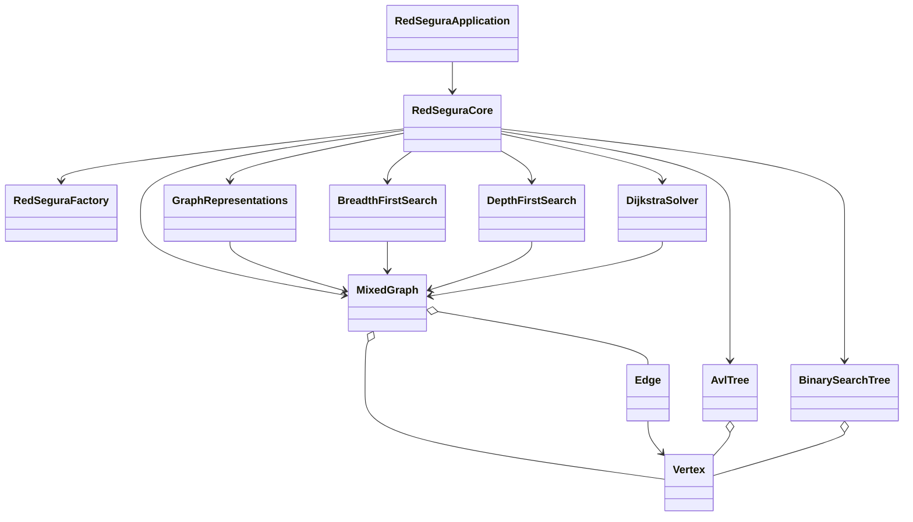

# RedSegura Sincelejo

Parcial 2 de Estructura de Datos II. Aplicación de consola en **Java 17 + Maven** que modela con árboles y grafos una red de atención de emergencias en Sincelejo (universidades, salud, transporte). Los tiempos son datos didácticos de simulación, no información oficial.

**Autor:** luis miguel acosta· **Docente:** Jaider Enrique Reyes Herazo · **Periodo:** 2026

## Cómo ejecutar

Requisitos: JDK 17 o superior y Maven.

```bash
git clone https://github.com/TU_USUARIO/RedSegura.git
cd RedSegura
mvn test
mvn compile exec:java -Dexec.mainClass=com.mycompany.redsegura.aplicacion.RedSeguraApplication
```

Desde Apache NetBeans: abrir el proyecto, clic derecho sobre `RedSeguraApplication.java` → *Run File*.
Para correr las pruebas: clic derecho sobre el proyecto → *Test*.

La medición ABB vs AVL se ejecuta con la clase `BenchmarkArboles`.

## Menú de la aplicación

| Opción | Consulta |
|---|---|
| 1 | Q1: buscar "Hospital Universitario" en ABB y AVL |
| 2 | Q2: rotaciones LL, RR, LR y RL |
| 3 | Q3: lista de adyacencia, matriz de adyacencia y de incidencia |
| 4 | Q4: BFS y DFS desde S02 (o desde otra raíz) |
| 5 | Q5: Dijkstra S02 → S08 (24 min) |
| 6 | Q6: bloquear R16 y recalcular |
| 7 | Q7: vértice inexistente sin cerrar el programa |
| 8 | Ruta personalizada |
| 9 / 10 | Bloquear / restaurar una conexión cualquiera |

## Arquitectura



- `RedSeguraApplication` solo habla con `RedSeguraCore`.
- `RedSeguraCore` usa `AvlTree`, `BinarySearchTree` y `MixedGraph`.
- Ningún módulo lee campos privados de otro: toda la comunicación es por métodos públicos.
- No se usan librerías que implementen AVL, BFS, DFS o Dijkstra.

Paquetes: `modelo`, `arboles`, `grafo`, `representaciones`, `algoritmos`, `aplicacion`.

## Complejidad

V = vértices, E = conexiones, n = nodos del árbol, h = altura.

| Componente | Tiempo | Espacio |
|---|---|---|
| ABB: insert, search, delete | O(h), peor caso O(n) | O(n) |
| AVL: insert, search, delete | O(log n) | O(n) |
| Recorridos de árbol (in/pre/post) | O(n) | O(h) por la recursión |
| BFS | O(V + E) | O(V) |
| DFS | O(V + E) | O(V) |
| Dijkstra con PriorityQueue | O((V + E) log V) | O(V) |
| Lista de adyacencia | construcción O(V + E) | O(V + E) |
| Matriz de adyacencia | construcción O(V² + E) | O(V²) |
| Matriz de incidencia | construcción O(V · E) | O(V · E) |

## Resultados de control

- Dijkstra S02 → S08: **24 minutos** por S02, S01, S07, S08.
- Con R16 bloqueada: la ruta cambia a S02, S01, S09, S10, S08 y el costo sigue siendo 24 (empate: 8+5+3+8 = 8+4+12).
- Pruebas JUnit 5: **61 pruebas, 0 fallos**.

## Pruebas

JUnit 5 cubre casos normales, vértices inexistentes, IDs duplicados, pesos inválidos, grafos desconectados, respeto de la orientación y las cuatro rotaciones AVL.
